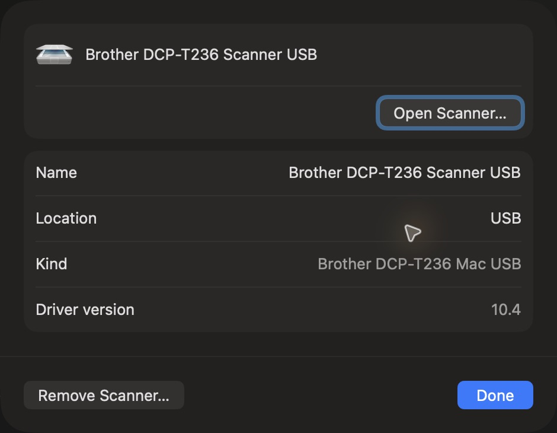
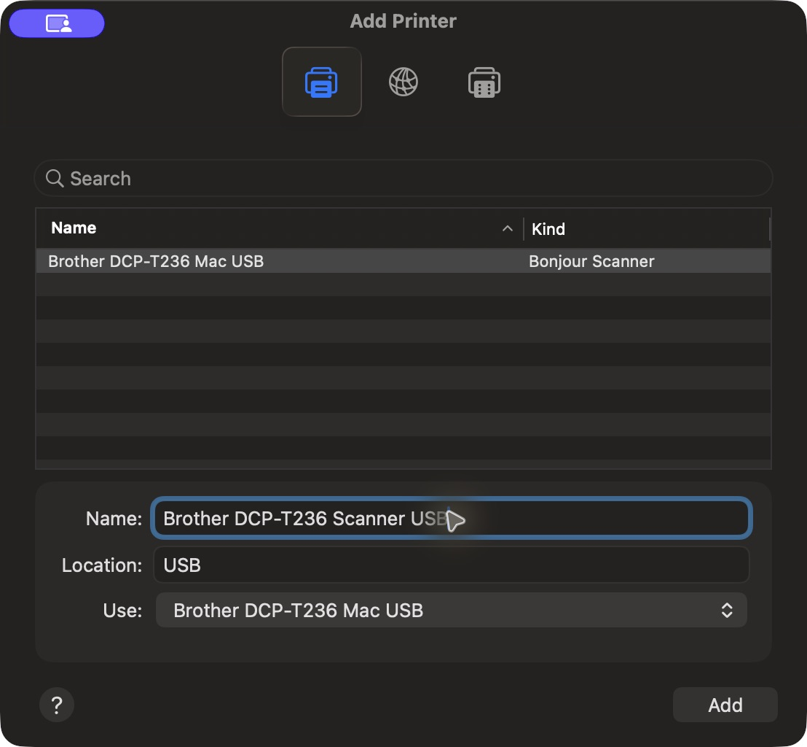

# Brother DCP-T236 USB printing and scanning for macOS

[](https://github.com/agooddaytowork/brother-dcp-t236-macos/actions/workflows/build.yml)
[](LICENSE)

Print from Word, Preview and other macOS apps, and scan from Image Capture using a Brother DCP-T236 connected by USB. The print helper runs natively; the scanner uses Python and libusb. No Windows, Linux VM, Rosetta or Brother proprietary binary is needed at runtime.

**Experimental community driver.** Physically tested with a DCP-T236 on Apple Silicon running macOS 26: a Word document, a full-color A4 photo and scans saved through Image Capture. Intel packages receive CI build/offline checks; Intel USB operation and other printer models are unverified. This project is not affiliated with Brother.



## What works

| Feature | Support |
| --- | --- |
| Print from macOS print dialogs | PDF input, A4, 300 dpi, color or grayscale |
| Multiple pages, copies and page ranges | Supported by the print helper |
| Flatbed scan in Image Capture | 300 dpi, color or grayscale, JPEG/PNG transfer |
| PDF scan export | Offered by macOS; not part of the bridge's transport or CI hardware tests |
| Printers & Scanners shortcut | Add the advertised Bonjour Scanner once |
| Startup | Services start when the installing user logs in |
| Duplex, borderless, other paper sizes, ink levels | Not implemented |
| Other Brother models | Not supported by this release |

The scanner performs one verified full-bed color acquisition, then applies requested cropping or grayscale conversion locally. An A4 region may include up to one white pixel at the right and four at the bottom because the USB JPEG scan extent is block-aligned. Some macOS JPEG exports use 72-dpi metadata even though the image contains approximately 2480 × 3508 pixels at the requested 300-dpi scan resolution.

## Install

### 1. Prepare your Mac and printer

- macOS **14 or later**, Apple Silicon or Intel. Only macOS 26 / Apple Silicon has been physically validated.
- Install [Homebrew](https://brew.sh/) if it is not already installed.
- Turn on the printer and connect it directly to the Mac with a USB cable.
- Finish existing print jobs before installing. Use one Mac account for this USB printer; simultaneous use from multiple logged-in accounts is not supported.

### 2. Download and install

Download an archive from [Releases](https://github.com/agooddaytowork/brother-dcp-t236-macos/releases/latest):

| Mac | Archive |
| --- | --- |
| Apple Silicon (M1 or later) | `brother-dcp-t236-macos-arm64.tar.gz` |
| Intel | `brother-dcp-t236-macos-x86_64.tar.gz` |

Extract the archive, open Terminal in the extracted folder, then run:

```sh
./install.command
```

The installer installs `python@3.14` and `libusb` through Homebrew if missing, creates a private Python environment, detects your printer's USB serial, and installs two login services plus the print queue. It downloads pinned Python packages from PyPI. It does not print a test page or change your default printer. If macOS requires it, `lpadmin` prompts for administrator authorization; type the password directly in Terminal (characters remain hidden). Run the installer as your normal user, without putting `sudo` before it.

The release helper is ad-hoc signed, not Apple Developer ID signed or notarized. Your Mac's security policy may require approval; managed Macs may prohibit it. Review the source or build locally if you prefer. Do not disable Gatekeeper globally.

For a source installation:

```sh
git clone https://github.com/agooddaytowork/brother-dcp-t236-macos.git
cd brother-dcp-t236-macos
./install.command
```

Source builds also need Apple's Command Line Tools (`xcode-select --install`). The installer builds the native print helper with the system SDK.

### 3. Print

Open your document in Word or Preview, press **⌘P**, choose **Brother DCP-T236 Mac USB**, select **A4**, then print. Start with one page. The queue communicates with a local IPP bridge, which converts PDF into the USB format understood by the printer.

### 4. Scan in Image Capture

1. Put the page face down on the scanner glass and close the lid.
2. Open **Image Capture** and select **Brother DCP-T236 Mac USB** under **Shared**. The Shared label is macOS's discovery category; the bridge is accessible only on this Mac.
3. Click **Show Details** if needed and wait for the overview, usually around 15–35 seconds in the tested setup.
4. Set **Color**, **300 dpi**. For a full sheet, clear **Use Custom Size** and choose **A4**. This avoids macOS splitting a photo into multiple detected items.
5. Choose **Scan To**, a file name and format, then click **Scan**.


### 5. Optional: add a Settings shortcut

Image Capture already works without this step.

Open **System Settings → Printers & Scanners → Add Printer, Scanner, or Fax…**. Authenticate on your Mac if asked. Select the **Bonjour Scanner** row named **Brother DCP-T236 Mac USB**. Do not select the plain USB printer row: the installer has already created the print queue.



Set its **Name** to **Brother DCP-T236 Scanner USB**, then click **Add**. A separate name avoids the duplicate-printer warning. The scanner appears under **Scanners**; select it and click **Open Scanner…**.


## Update or uninstall

Finish pending print and scan jobs, extract the newer release, and run `./install.command` again. Existing configuration and the previous helper/LaunchAgents are backed up in the runtime's `backups` folder. This is a diagnostic backup, not an automatic rollback system.

To remove the services:

```sh
./uninstall.command
```

The uninstaller unloads only this project's two login services and removes the print queue only if this installer originally created it and it still points to this bridge. It preserves the runtime directory, backups and logs. Remove the optional Scanner entry manually in System Settings. A pre-existing print queue is preserved.

## Troubleshooting

| Symptom | What to check |
| --- | --- |
| Printer not found during install | Power on, reconnect USB, and connect exactly one DCP-T236. Multiple devices can be selected with `./install.command --device-uri 'usb://Brother/DCP-T236?serial=YOUR_SERIAL'`. |
| Existing queue belongs to another driver | The installer refuses to overwrite it. Rename/remove that queue in Settings, then retry. Other printer queues are untouched. |
| No scanner under Shared | Reopen Image Capture, check USB and power, then log out/in or rerun the installer. |
| Printing waits while scanning | Expected: both services share a USB lock and take turns. |
| Scanner added twice | Keep one scanner shortcut in Settings; this does not require another print queue. |
| Port 8631 or 8632 is busy | Another instance/account or service may be running. The installer refuses an unrecognized service on those ports. |
| First installation fails downloading packages | Check Internet access and Homebrew/PyPI availability, then rerun. |

Logs live in `~/Library/Logs/Brother DCP-T236 Mac/`. Before posting logs or screenshots publicly, remove usernames, document titles, serial numbers and paths. Print jobs may retain PDF files in the private runtime spool directory; do not attach that folder to issues.

## Build, test and CI

```sh
brew install python@3.14 libusb
python3.14 -m venv .venv
source .venv/bin/activate
pip install -r requirements.txt
make test
make package
```

CI builds on native **arm64 (`macos-14`)** and **x86_64 (`macos-15-intel`)** runners. Tests exercise PDF scale/orientation/color handling, invalid inputs, eSCL requests and scanner crop/format conversion using a simulated USB acquisition. They do not claim hardware coverage. Each successful build uploads a source-complete archive and SHA-256 checksum as workflow artifacts. Pushing a `v*` tag publishes the two tested archives as a GitHub release after both jobs pass.

## How it works

```text
Word / Preview → CUPS → localhost:8631 → native PDF/PWG helper → USB printer
Image Capture  → local Bonjour / eSCL on 127.0.0.1:8632 → Python/libusb → scanner
                                      shared USB lock
```

Everything runs under the installing user. Printing binds to loopback, scanning binds to `127.0.0.1`, and scanner Bonjour registration uses Apple's local-only interface. There is no cloud service, telemetry, or LAN scanner sharing. The services remain available while that user is logged in; they are not a system-wide print server.

Installed runtime: `~/Library/Application Support/Brother DCP-T236 Mac/`. LaunchAgents: `com.local.brother-t236-mac` and `com.local.brother-t236-airscan` in `~/Library/LaunchAgents/`.

## License and credits

GPL-2.0-or-later. See [LICENSE](LICENSE), [NOTICE](NOTICE) and [scanner provenance](third_party/scanner-provenance.md).

The USB scan protocol implementation is adapted from [farafonoff's Brother DCP-T230 driver](https://github.com/farafonoff/Brother-DCP-T230-MacOS-driver/tree/main/scanner). This project adds DCP-T236 adaptations, the local eSCL integration, the native PDF printing path, packaging and installation. Apple's AirScan support supplies the native scanner UI. Brother product names are trademarks of Brother Industries, Ltd.
